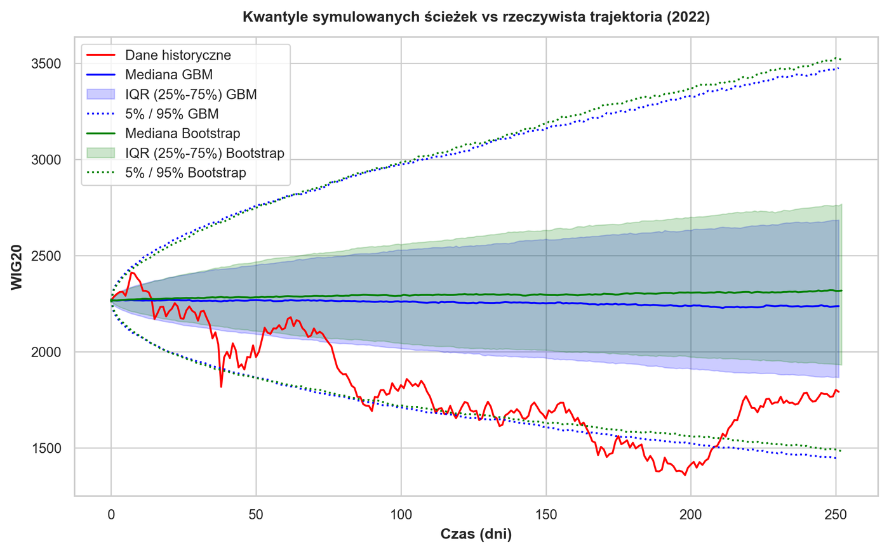
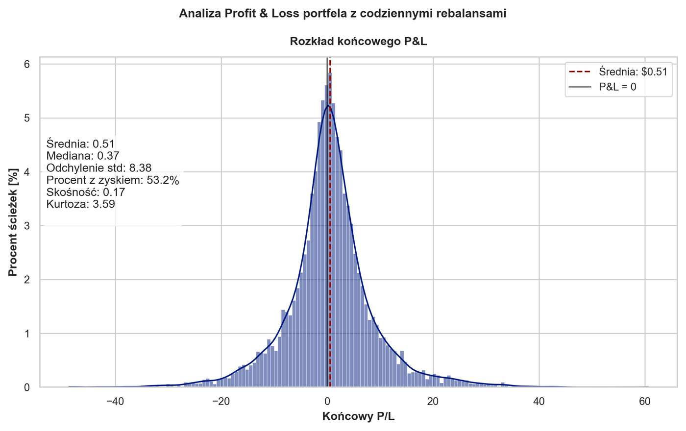
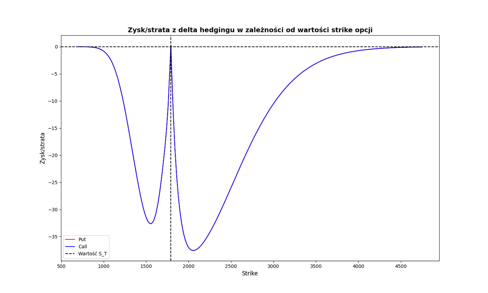

# Delta & Delta-Gamma Hedging on WIG20

**Simulation study of option hedging in the Black–Scholes world vs. the real market: WIG20 in 2022, the year the war in Ukraine began.**


The question: how well does a textbook delta hedge protect a short option position when the market stops behaving like geometric Brownian motion? The analysis is set on 1 January 2022. Parameters are calibrated on two years of WIG20 history. The strategy is then stress-tested on 10,000 simulated paths and on the actual 2022 price path. In the second part we add transaction costs and build **delta-gamma hedges that use binary options**, including a numerically stable closed form for the hedge ratio.

## Key results

| | |
|---|---|
| **Calibration** (2y daily log-returns) | σ = 26.56%, μ = 2.65%, r = 3.46% (1Y Polish T-bond), S₀ = 2266.92 |
| **Model check** | Simulated vs. theoretical terminal mean 2326.80 vs. 2321.56, volatility 0.2654 vs. 0.2656 |
| **Real returns vs. GBM** | Normality rejected (Shapiro–Wilk p = 2.4e-6). After removing the two crash/rebound days it is not rejected (p = 0.48) |
| **Daily delta hedge, simulated** | P&L centred at 0, but with heavy tails. Rarer rehedging shifts the median up and adds large losses |
| **Volatility misspecification** | Underestimating σ produces systematic losses and a fat left tail. This is the main risk driver |
| **Risk premium** | Expected loss given a 0–20 pp volatility shock: −17.26, about 3.33% of the call price |
| **Real 2022 path** (K = 1800, daily rehedge) | Final P&L −3.86 for both call and put, identical as predicted by put–call parity |
| **With 0.4% transaction costs** | Delta-gamma hedge with barriers beats the barrier delta hedge (P&L moments closer to 0) |

<p align="center">
  
  
</p>
<p align="center"><em>Left: GBM and bootstrap quantile fans vs. the real WIG20 path in 2022. Right: final P&L of a daily-rehedged short call (10,000 paths).</em></p>

## What's inside

**Part 0: data and simulation**
- Estimating μ and σ from rolling windows, with a short geopolitical rationale for the chosen window
- Path simulation with **GBM** and with a **historical bootstrap** of daily returns, compared with the real 2022–2023 path
- Payoff distributions of vanilla calls and puts. Correlated WIG20/KGHM paths (ρ = 0.7489) via a Cholesky-style construction

**Part A: abstract vs. real world**
- Delta hedging a short European option. Sensitivity of P&L to rehedging frequency, strike, assumed σ, μ and r
- Backtest on the real 2022 path: portfolio composition over time and cumulative P&L. The cash leg of the call and put hedges is shown to differ by exactly `K·e^{-r(T-t)}`

**Part B: beyond plain delta hedging (0.4% costs, weekly rehedge)**
- **Barrier delta hedge** with a *delta margin* (snap Δ to 0/1 deep ITM/OTM) and a *rehedge margin* (skip small corrections), grid-optimised
- **Delta-gamma hedge with one binary put**. The naive ratio α = Γ_V / Γ_BP is numerically unstable (e.g. 10⁻¹⁰⁰ / 10⁻¹⁰²), so it was derived analytically into a stable closed form. Variants with a free binary strike and a capped exponent were also tested
- **Two binary options (call + put)**: two ideas for fixing the free parameter, gamma-peak alignment and cost minimisation

<p align="center">
  
</p>
<p align="center"><em>Delta-hedge P&L on the real 2022 path as a function of strike. Hedging is hardest near the money.</em></p>

## Repository structure

```
src/delta_hedge/      pricing (Black–Scholes, Greeks), simulation (GBM, bootstrap),
                      hedging strategies, backtesting, data loading, plots
scripts/              run_analysis, bootstrap_analysis, minimize_costs, plots/ (animations)
results/figures/      selected figures; results/animations/ interactive HTML
reports/              full report (PDF, in Polish)
archive/              earlier variants kept for reference
```

## How to run

```bash
python -m pip install -e .
python -m scripts.run_analysis
```

The analysis needs the daily price files `wig20_d_full.csv` and `kgh_d.csv` in `data/raw/`. They are not in the repository; see [`data/raw/README.md`](data/raw/README.md). Smoke tests: `python -m unittest discover -s tests`.

## Report

📄 [Full report (PDF, Polish, 54 pages)](reports/IF1_Projekt1.pdf)

**Authors:** Maciej Karawan, Aleksander Żurowski. Financial Engineering I course project, April 2025.
